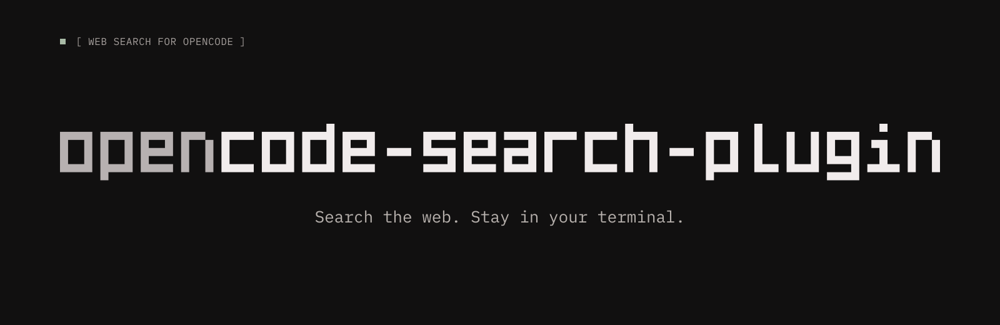

# opencode-search-plugin

**English** · [简体中文](README.zh-CN.md)

[](https://www.npmjs.com/package/opencode-search-plugin)
[](https://www.npmjs.com/package/opencode-search-plugin)
[](LICENSE)



**Web search for OpenCode that works out of the box, no API key required.**

AnySearch, Keenable, and You.com work immediately without any configuration. Other providers activate only when an API key is configured, ensuring you are not billed for unused services.

OpenCode's `random` mode can retry another available provider when an adapter reports a recognized rate limit (see [provider selection](#skip-the-provider-prompt)). Providers that require a key stay out of the pool until one is configured.

```sh
opencode plugin add opencode-search-plugin
```

After installation, ask OpenCode any question that requires a web search.

## Skip the provider prompt

On your first search, OpenCode prompts you to select a search provider. Set `websearch.provider` in your configuration to bypass this prompt:

```jsonc
{
  "$schema": "https://opencode.ai/config.json",
  "websearch": { "provider": "random" }
}
```

`"random"` selects an available provider and keeps using it within the session. A rate limit recognized by the host can move the session to another provider. Pinning an ID such as `"osp-brave"` keeps that provider selected even when a request fails; `false` disables web search.

All twenty-four adapters preserve OpenCode's typed HTTP 429 contract and the standard `Retry-After` header. An ordinary error containing "429" is insufficient. Yuanbao also converts its documented `RequestLimitExceeded` business error; other error statuses are not reclassified as throttles. The host owns switching and cooldowns: within one WebSearch service instance, sessions share provider cooldowns, and a missing or invalid `Retry-After` defaults to 60 seconds in OpenCode 2.2.5. Random failover and cooldown exclusion were exercised with simulated Brave and Zhipu responses in an isolated 2.2.5 host; Yuanbao was verified separately with simulated responses.

<!-- TODO: replace this comment with a 10-second GIF:
     set websearch.provider -> ask a question -> provider responds with sources -->

## Supported providers

[AnySearch](https://www.anysearch.com/) · [Bocha](https://bocha.ai/) · [Brave Search](https://brave.com/search/api/) · [DeepSeek](https://api-docs.deepseek.com/guides/search/) · [Doubao](https://www.volcengine.com/product/SearchInfinity) · [Jina](https://jina.ai/) · [Kagi](https://kagi.com/) · [Keenable](https://keenable.ai/) · [Linkup](https://www.linkup.so/) · [Metaso](https://metaso.cn/) · [Moonshot](https://platform.kimi.ai/) · [Moonshot CN](https://platform.kimi.com/) · [Ollama](https://ollama.com/) · [Perplexity](https://www.perplexity.ai/) · [Querit](https://querit.ai/) · [SerpApi](https://serpapi.com/) · [Serper](https://serper.dev/) · [StepFun](https://platform.stepfun.com/) · [You.com](https://you.com/) · [Yuanbao](https://cloud.tencent.com/document/product/1806) · [Z.ai](https://z.ai/) · [Z.ai Coding Plan](https://docs.z.ai/devpack/mcp/search-mcp-server) · [Zhipu](https://bigmodel.cn/) · [Zhipu Coding Plan](https://docs.bigmodel.cn/cn/coding-plan/mcp/search-mcp-server)

## Why this exists

OpenCode v2 ships with several built-in search providers: `exa`, `firecrawl`, `parallel`, `tavily`, and `tinyfish`. In addition, many external search APIs offer free tiers or generous free quotas.

This plugin integrates those providers into OpenCode:

- AnySearch, Keenable, and You.com work immediately without an API key or account.
- Multiple providers offer free tiers, making it practical to maintain a low-cost backup pool.
- Expands OpenCode's `random` mode pool, with failover available when the adapter reports a limit in the form the host recognizes.

## Install

Choose your preferred installation method. **npm is recommended**: published versions are immutable, so pinning with `@<version>` guarantees a consistent build.

### 1. From npm (recommended)

```sh
# Append @<version> to pin a specific version
opencode plugin add opencode-search-plugin
```

Or declare it in `opencode.json(c)`:

```jsonc
{
  "$schema": "https://opencode.ai/config.json",
  "plugins": ["opencode-search-plugin"]
}
```

### 2. From GitHub

```sh
# Append #v<version> to pin a specific tag
opencode plugin add github:guotree/opencode-search-plugin
```

Or declare it in `opencode.json(c)`:

```jsonc
{
  "$schema": "https://opencode.ai/config.json",
  "plugins": ["github:guotree/opencode-search-plugin"]
}
```

### 3. By copying a file

Each provider plugin is a self-contained `.ts` file with no relative imports and no build step. Place it in one of OpenCode's auto-discovery directories:

```text
~/.config/opencode/plugins/            # global
<project>/.opencode/plugins/           # project-scoped
```

For directories outside the auto-discovery paths, specify the file path explicitly:

```jsonc
{ "plugins": ["./plugins/brave-search.ts"] }
```

> Do not install the package *and* copy individual plugin files. Both register the same provider IDs, which will duplicate entries in the search pool.

### Skip providers you don't use

Installing the package registers all providers, but providers without configured API keys remain inactive (see [Keys](#keys)). To completely exclude or restrict providers, use `disable` or `enable`:

```jsonc
{
  "plugins": [
    {
      "package": "opencode-search-plugin",
      "options": { "disable": ["osp-serper", "osp-serpapi", "osp-youcom"] }
    }
  ]
}
```

- `disable`: Deny-list of provider IDs (from the table below). Because AnySearch, Keenable, and You.com require no key, `disable` is the only way to remove them from the pool.
- `enable`: Allow-list of provider IDs. Only the listed IDs are registered. For example, `"enable": ["osp-brave", "osp-jina"]` activates only those two.

If both are specified, **`disable` takes precedence on any overlap**:

```jsonc
{
  "options": {
    "enable": ["osp-brave", "osp-jina", "osp-serper"],
    "disable": ["osp-serper", "osp-youcom"]
    // osp-serper is excluded: disable overrides enable.
    // osp-youcom was not in enable, so it is safely ignored.
  }
}
```

The active set is computed as `enable - disable`. Overlapping IDs are dropped, and invalid or unrecognized IDs produce a warning in the logs rather than failing silently.

## Upgrade

```sh
# Installed from npm
opencode plugin update opencode-search-plugin
# Installed from GitHub
opencode plugin update github:guotree/opencode-search-plugin
# Update all outdated plugins
opencode plugin update
```

The update target must match the configured plugin specifier:
- For npm installations, use the package name (`opencode-search-plugin`).
- For GitHub installations, use the full `github:` specifier (using a bare package name will return `Plugin is not configured`).

Run `opencode plugin check` first to inspect available updates. Unpinned installations update to the latest release. Pinned installations (`@<version>` on npm, `#v<version>` on GitHub) remain at their pinned version until you edit the specifier in `opencode.json(c)` or run `plugin add` with a new version. For locally copied files, replace the existing `.ts` file with the newer version.

## Uninstall

```sh
# Installed from npm
opencode plugin remove opencode-search-plugin
# Installed from GitHub
opencode plugin remove github:guotree/opencode-search-plugin
```

Pass the same specifier used during installation. This command updates global configuration. If the plugin was configured as an entry in `opencode.json(c)` or as a local file, remove the configuration entry or delete the copied `.ts` file. Saved `/connect` credentials are preserved and will be recognized upon reinstallation. To deactivate specific providers without removing the entire plugin, use `enable` / `disable` as described above.

## Keys

Every provider except AnySearch, Keenable, and You.com requires an API key. You can provide credentials in one of two ways:

- **`/connect` in OpenCode**: Stored per provider, rotatable without restarting OpenCode, and unaffected by environment changes.
- **Environment variables**: Read as a fallback for headless, automated, or CI environments.

Environment variables use the `OSP_<PROVIDER>_API_KEY` namespace (e.g., `OSP_BRAVE_API_KEY`) to prevent naming collisions with other tools that export vendor variables. Credentials stored in `/connect` always take precedence over environment variables.

A provider that requires a key remains unbound while no key is configured, so `"provider": "random"` does not send requests to it without credentials.

Environment keys come from the running OpenCode server process. Changing a Windows user or system environment variable does not update a process that is already running. Ensure the server inherits the updated environment, or use `/connect` to update credentials immediately. Configuring a key makes a provider available; the upstream service still checks that the key is valid and the service is enabled.

AnySearch, Keenable, and You.com are exceptions. All three include an anonymous tier and are registered by default, attaching credentials only when a key is provided. For Keenable, the two tiers use separate quotas: configuring a key provides 100,000 free requests per month, whereas keyless requests route to the `/public` endpoint and are rate-limited to 1,000 requests/hour and 10 requests/second per IP (shared across all users on that egress address). For You.com, keyless requests route to the official hosted MCP free profile (`https://api.you.com/mcp?profile=free`), which provides daily evaluation searches without registration; configuring `OSP_YDC_API_KEY` routes to the commercial REST endpoint (`https://ydc-index.io/v1/search`) with dedicated quota and higher throughput. Configuring an API key removes dependence on that shared IP rate limit.

With keys configured, `websearch.provider` controls routing: `"random"` chooses an available provider per session (see [Skip the provider prompt](#skip-the-provider-prompt)), a specific ID such as `"osp-brave"` pins that provider, and `false` disables web search entirely.

## Providers

Each provider ID carries an `osp-` prefix to prevent name collisions with OpenCode's built-in providers or official vendor plugins (which use bare names like `exa` or `tavily`). Use the prefixed ID in `websearch.provider` and in `enable` / `disable` options.

In OpenCode's `/connect` settings, each provider is labeled with an `(osp)` suffix (e.g., `DeepSeek (osp)`) to distinguish it from built-in integrations. The search pool itself displays the clean provider name without the suffix.

| Provider | ID | Key (env / `/connect`) | Anonymous | Notes |
| --- | --- | --- | --- | --- |
| AnySearch | `osp-anysearch` | `OSP_ANYSEARCH_API_KEY` | yes | Free tier per IP; intent routing, `cn` / `intl` zones |
| Bocha | `osp-bocha` | `OSP_BOCHA_API_KEY` | no | Bing-compatible results; billed per search, and by token when summaries are requested |
| Brave Search | `osp-brave` | `OSP_BRAVE_API_KEY` | no | Independent index, 20 results max |
| DeepSeek | `osp-deepseek` | `OSP_DEEPSEEK_API_KEY` | no | In-house index; $0.75 per 1,000 successful requests; 5 QPS rate limit |
| Doubao | `osp-doubao` | `OSP_DOUBAO_API_KEY` | no | Volcengine's Doubao Search (Custom version); 500 free searches per month per account, billed per search after that; long page body per hit (cut to a code-point budget by default), up to 50 results, source-authority and time filters |
| Jina | `osp-jina` | `OSP_JINA_API_KEY` | no | Full-page content is opt-in due to token-based billing |
| Kagi | `osp-kagi` | `OSP_KAGI_API_KEY` | no | Ad-free subscription index with lenses; $12 per 1,000 requests, no free tier |
| Keenable | `osp-keenable` | `OSP_KEENABLE_API_KEY` | yes | 100,000 free requests/month with a key; keyless tier is rate-limited per IP |
| Linkup | `osp-linkup` | `OSP_LINKUP_API_KEY` | no | Four reasoning depths: `flash`, `fast`, `standard`, `deep` |
| Metaso | `osp-metaso` | `OSP_METASO_API_KEY` | no | Billed per search, not per result |
| Moonshot | `osp-moonshot` | `OSP_MOONSHOT_API_KEY` | no | Moonshot's international site (api.moonshot.ai); standalone search endpoint, billed per successful search at $0.002 (failed or empty searches are free); separate account system from the cn site |
| Moonshot CN | `osp-moonshot-cn` | `OSP_MOONSHOT_CN_API_KEY` | no | Moonshot's cn site (api.moonshot.cn); standalone search endpoint, billed ¥0.01 per successful search (failed or empty searches are free); separate account system from the international site |
| Ollama | `osp-ollama` | `OSP_OLLAMA_API_KEY` | no | Free personal tier; returns full-page markdown per result, cut to `OLLAMA_CONTENT_CHARS` (up to 10 results, no publication dates) |
| Perplexity | `osp-perplexity` | `OSP_PERPLEXITY_API_KEY` | no | Search API returns direct search results without generated answers; $5.00 / 1,000 requests ($1.00 with `fast`) |
| Querit | `osp-querit` | `OSP_QUERIT_API_KEY` | no | Falls back to sentence matches when a snippet is missing |
| SerpApi | `osp-serpapi` | `OSP_SERPAPI_API_KEY` | no | Google via SerpApi; includes SerpApi's free 1-hour server-side cache |
| Serper | `osp-serper` | `OSP_SERPER_API_KEY` | no | Google via Serper; billed per query in credits |
| StepFun | `osp-stepfun` | `OSP_STEPFUN_API_KEY` | no | StepFun's cn platform (api.stepfun.com); standalone search endpoint, billed ¥0.04 per search; four scenario biases (`programming`, `research`, `gov`, `business`); no time, domain or paging filters, and every hit carries its full page body |
| You.com | `osp-youcom` | `OSP_YDC_API_KEY` | yes | Combined web and news results; multiple extraction modes; keyless free tier via hosted MCP |
| Yuanbao | `osp-yuanbao` | `OSP_YUANBAO_API_KEY` | no | Tencent Cloud WSA; lite / standard / flagship at ¥14 / ¥20 / ¥26 per 1,000 calls; account tier selected in the console; lite verified live, other tiers pending; site and time filters |
| Z.ai | `osp-zai` | `OSP_ZAI_API_KEY` | no | Zhipu's international site (api.z.ai); standalone search endpoint, billed per search at $0.01 (Search-Prime); separate account system from Zhipu's cn site |
| Z.ai Coding Plan | `osp-zai-coding` | `OSP_ZAI_CODING_API_KEY` | no | Z.ai's Coding Plan Remote MCP search (`web_search_prime`); consumes plan shared credits (1.2 credits per call at implementation time), never falls back to the metered REST endpoint; experimental pending client-policy confirmation |
| Zhipu | `osp-zhipu` | `OSP_ZHIPU_API_KEY` | no | Zhipu's cn site (open.bigmodel.cn); standalone search endpoint, no model call; billed per search from ¥0.01 (Search-Std), no free tier; four engines including Sogou and Quark |
| Zhipu Coding Plan | `osp-zhipu-coding` | `OSP_ZHIPU_CODING_API_KEY` | no | Zhipu's Coding Plan Remote MCP search (`web_search_prime`); consumes plan shared credits (1.2 credits per call at implementation time), never falls back to the metered REST endpoint; experimental pending client-policy confirmation |

## Configuration

Configuration options are loaded as environment variables on startup. If you change a setting, restart OpenCode for it to take effect. Defaults reflect upstream API behavior and plugin choices for result size and request handling; content limits are configurable preview sizes, not model-specific safety thresholds.

Search providers work independently of the model consuming their results: choosing Ollama search does not imply a local model, and choosing Moonshot search does not imply a particular context window. Where supported, `*_CONTENT_CHARS` limits the beginning of each selected content field in Unicode code points, with `…` appended when truncated. `0` disables that per-hit truncation. These limits apply before results are returned and cached; they do not cap total search output, token usage, or response download and parsing memory. Titles, URLs, result counts and repeated searches add further context cost. The plugin currently has no aggregate output budget.

**Behavior change:** Jina, Moonshot and Moonshot CN now default to 4,000 code points per hit, including the snippet path. Users who enabled full-page content and need it without local truncation must set the corresponding `*_CONTENT_CHARS` to `0`. Truncated content is a preview and may omit relevant passages later in the page.

### Shared by every provider

| Variable | Default | Description |
| --- | --- | --- |
| `<PROVIDER>_CACHE_TTL` | `600000` | Duration in milliseconds to reuse cached responses for identical normalized queries (`0` disables caching). A hit refreshes the entry's recency so hot queries survive eviction; an empty result set is remembered for at most 30 seconds so a transient upstream wobble does not lock retries out for the full window |
| `<PROVIDER>_TIMEOUT` | `25000` | Deadline in milliseconds covering the request and response-body reading (`0` removes the deadline while preserving cancellation in both phases) |

### AnySearch

| Variable | Default | Description |
| --- | --- | --- |
| `ANYSEARCH_MAX_RESULTS` | `10` | Results per search, clamped to 1–10 |
| `ANYSEARCH_TAG` | — | Pins the intent router to a sub-domain, e.g., `code.snippet`. Sub-domains that declare required parameters (`code.doc` needs `library`, most `finance.*` need `type`) cannot be used: the plugin sends no `params` channel, so the API answers 400 naming what is missing |
| `ANYSEARCH_ZONE` | — | Geographic zone: `cn` or `intl`; an unknown value is reported and dropped rather than silently ignored |
| `ANYSEARCH_LANGUAGE` | — | Preferred result language, e.g., `zh-CN` |
| `ANYSEARCH_FORMAT` | `markdown` | Content format: `markdown` or `json`; an unknown value is reported and dropped rather than silently ignored. It shapes the `content` field's extraction, not its serialization: `markdown` is the fuller markdown body with heading structure, while `json` is a plain-text description where `content` degrades to the snippet and costs far fewer context tokens |
| `OSP_ANYSEARCH_API_KEY` | — | Optional; anonymous access is used when omitted |

### Bocha

| Variable | Default | Description |
| --- | --- | --- |
| `BOCHA_COUNT` | `10` | Results per search, clamped to 1–50 (Bocha's maximum) |
| `BOCHA_FRESHNESS` | — | Freshness filter: `noLimit`, `oneDay`, `oneWeek`, `oneMonth`, `oneYear`, `YYYY-MM-DD`, or `YYYY-MM-DD..YYYY-MM-DD`. Omitting this parameter is recommended by Bocha, as upstream query rewriting may yield empty results for fixed ranges |
| `BOCHA_SUMMARY` | `off` | `true` replaces snippets with generated summaries (provides more context at higher per-request cost) |

### Brave Search

| Variable | Default | Description |
| --- | --- | --- |
| `BRAVE_NUM` | `8` | Results per search, clamped to 1–20 (Brave's maximum) |
| `BRAVE_COUNTRY` | — | Two-letter country code, or `ALL` |
| `BRAVE_LANG` | — | Result language code, e.g., `en`, `zh-hans`, `pt-br` |
| `BRAVE_FRESHNESS` | — | Time filter: `pd` (24h), `pw` (7d), `pm` (31d), `py` (365d), or `YYYY-MM-DDtoYYYY-MM-DD` |

### DeepSeek

| Variable | Default | Description |
| --- | --- | --- |
| `DEEPSEEK_COUNT` | `10` | Results per search, clamped to 1–50 (DeepSeek's maximum). Billed per request; additional results incur no extra charge |

### Doubao

| Variable | Default | Description |
| --- | --- | --- |
| `DOUBAO_COUNT` | `10` | Results per search, clamped to 1–50 (Doubao's maximum) |
| `DOUBAO_AUTH_LEVEL` | `off` | `1`–`4` keeps only results at that source-authority level (`1` is government, state media, universities and major company official sites); an unknown value is reported and dropped rather than silently ignored |
| `DOUBAO_TIME_RANGE` | — | Freshness filter: `OneDay`, `OneWeek`, `OneMonth` or `OneYear`; an unknown value is reported and dropped rather than silently ignored |
| `DOUBAO_CONTENT` | `full` | `full` reads each hit's page body, `snippet` keeps only the query-relevant excerpt (roughly 600 characters, cut server-side); an unknown value is reported and dropped rather than silently ignored |
| `DOUBAO_CONTENT_CHARS` | `2000` | Code points kept from the beginning of each hit's selected content in either mode (`0` disables truncation); a per-hit preview limit |

Searches run through the Custom version of Doubao Search, Volcengine's search API built for AI agents (`POST open.feedcoopapi.com/search_api/web_search`, keys from the [Doubao Search console](https://console.volcengine.com/search-infinity/web-search-exp)). Billing is per search with 500 free searches per month per Volcengine account, so every dispatch is assumed billed and repeat queries ride the shared cache. This provider sends only what it can verify against the API reference: the query, `SearchType: "web"` and `Count`; the full page body (thousands of characters, where the sibling Global version returns a short snippet) comes back without asking for it. The Global version shares the same API key and free quota but speaks a different, snake_case protocol with a fixed 10 results and per-result token counts -- only the Custom version is wired up here.

### Jina

| Variable | Default | Description |
| --- | --- | --- |
| `JINA_NUM` | `0` | Results per search (1–100). `0` omits the parameter, preserving Jina's faster and broader result types |
| `JINA_INCLUDE_CONTENT` | `off` | `true` returns full-page markdown per hit, cut to `JINA_CONTENT_CHARS`; significantly increasing context and billed tokens |
| `JINA_CONTENT_CHARS` | `4000` | Code points kept from the beginning of each hit's selected content (`0` disables truncation). Applies to both full-page content and snippets |
| `JINA_GL` / `JINA_HL` | — | Country / language code |
| `JINA_LOCATION` | — | Simulated city-level location, e.g., `Berlin` |
| `JINA_TIMEOUT` | `25000` (`60000` with `JINA_INCLUDE_CONTENT`) | Request timeout in milliseconds; full-page fetching uses a higher default timeout |

### Kagi

| Variable | Default | Description |
| --- | --- | --- |
| `KAGI_NUM` | `8` | Results per search, clamped to 1–1024 (the API's range) |
| `KAGI_LENS` | — | Lens to apply: the identifier of a built-in lens, or a shareable lens ID from [kagi.com/settings/lenses](https://kagi.com/settings/lenses) -- the ID portion of the lens URL or the full URL. Kagi's prebuilt lenses include Programming, Forums and PDFs |
| `KAGI_RECENT` | — | Recency filter: `day`, `week`, or `month`. Sent as an inline lens, so it is ignored when `KAGI_LENS` is set; an unknown value is reported and dropped rather than sent to earn a 400 |
| `KAGI_REGION` | — | ISO 3166-1 alpha-2 region code, e.g., `us`, `cn` |

Searches run through Kagi's v1 API (`POST kagi.com/api/v1/search`, keys from [kagi.com/api/keys](https://kagi.com/api/keys)). Billing is $12 per 1,000 requests, pay-as-you-go with no free credit and no anonymous tier, so every dispatch is assumed billed and repeat queries ride the shared cache. Whether the account's own settings ride along is a per-key decision: checking `Inherit account settings in API requests` on the key (API dashboard, key settings) applies the account's block/promote rules and snippet length to API results. `workflow` is pinned to `search` (html pages); the images, videos and news workflows return other result collections and are not what an agent's web search wants. The endpoint can also inline page extraction in the same request, but that is billed per page at the Extract API's rate, so this provider never asks for it -- snippets are mapped instead.

### Keenable

| Variable | Default | Description |
| --- | --- | --- |
| `KEENABLE_MAX_RESULTS` | `10` | Results per search, clamped to 1–50 |
| `KEENABLE_MODE` | — | Search mode: `pro` (deeper retrieval) or `realtime` (faster); unset uses Keenable's default |
| `KEENABLE_TITLE` | `opencode-search-plugin` | Application identifier sent as `X-Keenable-Title`, required by the keyless endpoint for attribution |
| `OSP_KEENABLE_API_KEY` | — | Optional; keyless access is used when omitted |

### Linkup

| Variable | Default | Description |
| --- | --- | --- |
| `LINKUP_DEPTH` | `fast` | Search depth: `flash`, `fast`, `standard`, or `deep`; an unknown value is reported and dropped rather than silently ignored. Depth buys recall and latency, not text: the three returned the same excerpt lengths when measured |
| `LINKUP_MAX_RESULTS` | `10` | Requested results per search, clamped to 1–100. Recorded tests requesting 50 and 200 both returned 20; this observation is not a local result-count limit |
| `LINKUP_CONTENT_CHARS` | `4000` | Code points kept from the beginning of each hit's query-relevant excerpt (`0` disables truncation); a per-hit preview limit |

`content` is a query-relevant excerpt, not the page -- 375 to 4,395 characters across 85 measured hits, median near 2,000. The 4,000-code-point default is near the upper end of that observed range; it can still omit relevant text and does not guarantee answer completeness. `outputType` stays `searchResults`: `sourcedAnswer` would add an AI answer on top of source snippets that are the same text `results[].content` already holds (the lengths came back identical), and OpenCode's result shape has no field for an answer to live in. There is no server-side length control either -- unknown parameters are accepted and ignored.

### Metaso

| Variable | Default | Description |
| --- | --- | --- |
| `METASO_SEARCH_SIZE` | `20` | Results per search, clamped to 1–100 |
| `METASO_INCLUDE_RAW_CONTENT` | `off` | `true` returns full source text per hit without extra search cost, but substantially increases context tokens |

### Moonshot

| Variable | Default | Description |
| --- | --- | --- |
| `MOONSHOT_COUNT` | `5` | Results per search, clamped to 1–20 (the API's range and default) |
| `MOONSHOT_INCLUDE_CONTENT` | `off` | `true` sends `include_content` and reads each hit's full-page `text` instead of its snippet, cut to `MOONSHOT_CONTENT_CHARS`; billed the same per search, but substantially increases context tokens |
| `MOONSHOT_CONTENT_CHARS` | `4000` | Code points kept from the beginning of each hit's selected content (`0` disables truncation). Applies to both full-page text and snippets; a per-hit preview limit |

This is Moonshot's international site ([platform.kimi.ai](https://platform.kimi.ai)), with keys from [platform.kimi.ai](https://platform.kimi.ai/console/api-keys) and the Basic search endpoint at `api.moonshot.ai/v1/tools/search`. Billing is $0.002 per successful search, and only when the response carries at least one result -- failed and empty searches are free, and repeat queries ride the shared cache. There is no anonymous tier, so the provider binds only while a key exists.

The endpoint takes no paging, site, or time filter: `limit`'s 20 is the whole reach of one call, and the `sites` / `time_window` filters belong to the Pro endpoint (50% more, relevance-scored `chunks` instead of snippets), which this provider deliberately does not use. The query is sent intact -- the spec documents no length ceiling and searches it verbatim.

Search QPS is tiered by the account's cumulative recharge (1 QPS at Tier0, rising to 50), counted separately from the chat endpoints' limits; a 429 reports the reset time from `X-RateLimit-Reset`.

The cn site ([platform.kimi.com](https://platform.kimi.com)) is a separate account system with renminbi pricing and registers as its own provider, Moonshot CN (`osp-moonshot-cn`) below.

### Moonshot CN

| Variable | Default | Description |
| --- | --- | --- |
| `MOONSHOT_CN_COUNT` | `5` | Results per search, clamped to 1–20 (the API's range and default) |
| `MOONSHOT_CN_INCLUDE_CONTENT` | `off` | `true` sends `include_content` and reads each hit's full-page `text` instead of its snippet, cut to `MOONSHOT_CN_CONTENT_CHARS`; billed the same per search, but substantially increases context tokens |
| `MOONSHOT_CN_CONTENT_CHARS` | `4000` | Code points kept from the beginning of each hit's selected content (`0` disables truncation). Applies to both full-page text and snippets; a per-hit preview limit |

This is Moonshot's cn site ([platform.kimi.com](https://platform.kimi.com)), with keys from [platform.kimi.com](https://platform.kimi.com/console/api-keys) and the Basic search endpoint at `api.moonshot.cn/v1/tools/search`. Billing is ¥0.01 per successful search, and only when the response carries at least one result -- failed and empty searches are free, and repeat queries ride the shared cache. The request, mapping, and filter story are identical to the international site above, including the recharge-tiered search QPS (1 at Tier0, rising to 50).

The international site ([platform.kimi.ai](https://platform.kimi.ai)) is a separate account system with dollar pricing and registers as its own provider, Moonshot (`osp-moonshot`) above.

### Ollama

| Variable | Default | Description |
| --- | --- | --- |
| `OLLAMA_MAX_RESULTS` | `5` | Results per search, clamped to 1–10 (API maximum). Each result's `content` is a page body rather than a snippet, so the count multiplies with the per-hit budget below |
| `OLLAMA_CONTENT_CHARS` | `2000` | Code points kept from the beginning of each hit's page body (`0` disables truncation); a per-hit preview limit |

Ollama's docs describe `content` as "a relevant content snippet from the web page". In recorded live API tests, it instead contained whole-page text matching `web_fetch` output for the same URL. Across 20 hits from four queries it ranged from 348 to 208,805 characters (median around 10,000), and 17 of the 20 exceeded the 2,000 default. This supports limiting page previews, but does not establish 2,000 as an optimal threshold. No server-side content-length control was found in those tests -- unknown parameters were accepted and silently ignored -- so the plugin truncates the returned text locally. If a page-fetch tool is available, an agent can try to retrieve more from the source URL; it may not reproduce the search provider's content. Ollama's own agent example cuts the search output to 8,000 characters before the model reads it.

### Perplexity

| Variable | Default | Description |
| --- | --- | --- |
| `PERPLEXITY_MAX_RESULTS` | `10` | Results per search, clamped to 1–20 (web search supports up to 20; `search_type=people` accepts up to 50) |
| `PERPLEXITY_SEARCH_TYPE` | — | Search type: `web` (API default, $5.00 / 1,000 requests), `fast` ($1.00 / 1,000 requests, lower latency), or `people`; unset omits the parameter |
| `PERPLEXITY_RECENCY` | — | Recency filter: `hour`, `day`, `week`, `month`, or `year` |
| `PERPLEXITY_COUNTRY` | — | Two-letter ISO 3166-1 country code, e.g., `US` |
| `PERPLEXITY_LANGUAGE` | — | Comma-separated ISO 639-1 language codes, e.g., `en,zh` (maximum of 10 codes sent, adhering to the stricter quickstart limit) |

There is intentionally no domain or source filter configuration: the Perplexity API provides no dedicated toggle for news, Reddit, or academic search. Upstream documentation recommends using `search_domain_filter` allowlists per query rather than applying a global configuration.

### Querit

| Variable | Default | Description |
| --- | --- | --- |
| `QUERIT_COUNT` | `8` | Results per search |

### SerpApi

| Variable | Default | Description |
| --- | --- | --- |
| `SERPAPI_GL` / `SERPAPI_HL` | — | Country / language code |
| `SERPAPI_TBS` | — | Advanced search filter, e.g., `qdr:d` (past day), `qdr:y` (past year) |

There is intentionally no result-count configuration: Google deprecated the `num` parameter, so SerpApi no longer supports it.

### Serper

| Variable | Default | Description |
| --- | --- | --- |
| `SERPER_NUM` | `10` | Results per search, clamped to 1–100 |
| `SERPER_GL` / `SERPER_HL` | — | Country / language code |
| `SERPER_TBS` | — | Time filter: `qdr:h`, `qdr:d`, `qdr:w`, `qdr:m`, `qdr:y` |

### StepFun

| Variable | Default | Description |
| --- | --- | --- |
| `STEPFUN_COUNT` | `10` | Results per search, clamped to 1–20 (the API's range and default) |
| `STEPFUN_CATEGORY` | — | Scenario bias: `programming`, `research`, `gov`, or `business`. Unset searches every scenario, which is the API's default; an unknown value is reported and dropped rather than sent to earn a 400 |
| `STEPFUN_INCLUDE_CONTENT` | `off` | `true` returns each hit's full-page `content` instead of its snippet. The body is in every response either way — this only decides whether it is spent on context tokens |
| `STEPFUN_CONTENT_CHARS` | `4000` | Code points kept from the beginning of the page body when selected, including fallback from an empty snippet (`0` disables truncation). Snippets are not truncated; Unicode surrogate pairs are preserved |

StepFun's cn platform ([platform.stepfun.com](https://platform.stepfun.com/interface-key)) serves the only search endpoint: `POST api.stepfun.com/v1/search`, billed ¥0.04 per search. The international host has no equivalent (`api.stepfun.ai/v1/search` answers 404 while its chat endpoint does not), so there is no second provider to bind — unlike Moonshot's two sites.

The endpoint takes three parameters and nothing else: `query`, `n`, and `category`. There is no paging (`n`'s 20 is the whole reach of one call), no time range, no domain filter, and no safe-search switch, so a freshness or site filter has no lever here and is deliberately not exposed. `time` is the page's **index** time — when StepFun's crawler last saw it — not a publish date, and it is reported as `published` because it is the only time field there is.

Every hit carries `content`, the full page body, with no parameter to turn it off. That is why the snippet is the default: the body is paid for on the wire regardless, but it need not be paid for again in context tokens. `STEPFUN_INCLUDE_CONTENT` opts into reading it, and `STEPFUN_CONTENT_CHARS` bounds it. A hit whose snippet is empty still falls back to the truncated body, since an empty string is not an answer worth handing the agent. StepFun publishes no "empty searches are free" rule (unlike Moonshot), so every dispatch is assumed billed and repeat queries ride the shared cache. There is also no search-specific quota in the docs — the account's recharge-tiered concurrency/RPM limits are what apply.

The built-in `web_search` tool in Chat Completions is a different capability — the model decides whether to search, and the results are billed again as prompt tokens — and `step-5-preview` does not support it. This provider calls the standalone endpoint, which works with any model.

### You.com

| Variable | Default | Description |
| --- | --- | --- |
| `YOUCOM_COUNT` | `10` | Results per section (web and news each), clamped to 1–100 |
| `YOUCOM_EXTRACTION` | `highlights` | Extraction mode: `highlights` returns answering passages, `none` returns raw snippets, and `full_page` fetches full pages and bills per fetched page; an unknown value is reported and dropped rather than silently ignored |
| `YOUCOM_LANGUAGE` / `YOUCOM_COUNTRY` | — | Language / country code, e.g., `EN` / `US` |
| `YOUCOM_FRESHNESS` | — | Freshness filter: `day`, `week`, `month`, `year`, or `YYYY-MM-DDtoYYYY-MM-DD` |

Content is selected from the first nonblank value in highlights, Markdown, snippets, then description. Empty arrays and whitespace-only text do not hide usable fallback content; the selected text retains its original Markdown indentation and line breaks. This selection uses only fields already returned by the service and makes no extra requests.

### Yuanbao

Available from **v4.6.0**, including the standalone `plugins/yuanbao-search.ts` provider.

1. Complete Tencent Cloud real-name verification, enable Yuanbao Search and create a **service API key** in the [Yuanbao Search console](https://console.cloud.tencent.com/wsapi/index?tab=apikey). The AK/SK signing credential for Tencent Cloud API 3.0 is a different credential type.
2. In OpenCode, run `/connect` and select **Yuanbao Search (osp)**, or provide `OSP_YUANBAO_API_KEY` in the server's environment. A saved `/connect` key takes precedence over the environment variable.
3. Pin the provider in `opencode.json(c)`, or use `random` to include it in the available pool:

```jsonc
{
  "$schema": "https://opencode.ai/config.json",
  "websearch": { "provider": "osp-yuanbao" }
}
```

| Variable | Default | Description |
| --- | --- | --- |
| `YUANBAO_COUNT` | — | Omits `Cnt` by default for lite compatibility. Explicit values: `10`, `20`, `30`, `40`, `50` (standard/flagship only); sent as an integer, never rounded or clamped |
| `YUANBAO_SITE` | — | One domain such as `qq.com`, or `exclude:qq.com\|sohu.com` to exclude up to five domains; no URL scheme or path |
| `YUANBAO_FRESHNESS` | — | Calendar-based freshness: `d1`–`d30`, `m1`–`m12`, `y1`–`y5`. Absolute dates and date ranges are not exposed in this version |
| `YUANBAO_INDUSTRY` | — | `gov`, `news`, `acad` or `finance` (standard/flagship only) |
| `YUANBAO_CACHE_TTL` | `600000` | Cache lifetime in milliseconds; `0` disables caching. Normal empty results are cached for at most 30 seconds |
| `YUANBAO_TIMEOUT` | `25000` | Request and response-body timeout in milliseconds; `0` removes the deadline while retaining cancellation |
| `OSP_YUANBAO_API_KEY` | — | Service API key from the [Yuanbao Search console](https://console.cloud.tencent.com/wsapi/index?tab=apikey); requires real-name verification and service activation |

Uses `POST https://api.wsa.cloud.tencent.com/SearchPro` with Bearer authentication, without a Tencent Cloud SDK or AK/SK signing. All three tiers use this endpoint; the server applies the account's active tier, which is selected in the console. `Response.Version` reports the tier and is not a request setting. Only `Query` is sent by default: lite does not support `Cnt`, `Industry` or `Mode`. Invalid optional settings are warned about and omitted. Tier-incompatible parameters are reported without retrying a broader search. Vertical-card modes and attachment links are not exposed yet. The site filter targets public web results; the upstream spec does not apply it to vertical cards that a higher tier may also return.

Each `Pages` entry is a JSON string and is decoded separately. Missing URLs and malformed entries are dropped while usable sources keep their order; an entirely unusable non-empty page list is an error. Content prefers the dynamic excerpt (`content`) over the standard excerpt (`passage`), with known `<strong>` highlights removed. These are excerpts, not full page bodies; this provider currently applies no local content cutoff. Dates without an explicit timezone are omitted because the documented wall-clock timestamps have no timezone contract.

HTTP 200 business errors and the known `hit black query` refusal are reported and never cached as empty results. Both HTTP 429 and business code `RequestLimitExceeded` use the Effect HTTP error contract OpenCode needs for `random` failover, preserving `Retry-After` and reporting the actual upstream status. Other errors remain terminal. Normal empty results use the shared short cache; empty results with an informational message are not cached.

[Official pricing](https://cloud.tencent.com/document/product/1806/121798) is ¥14 / ¥20 / ¥26 per 1,000 calls for lite / standard / flagship; flagship is enterprise-only. Failed calls are free, while successful empty-call billing is unspecified. The advertised 2,000 free calls/month is a promotion whose eligibility and validity must be checked in the console. The [official FAQ](https://cloud.tencent.com/document/product/1806/121804) currently says WeChat public-account content is unsupported. After switching account tiers, cached results can persist until expiry; use `YUANBAO_CACHE_TTL=0` when verifying a tier change.

A valid-key lite smoke test on 2026-11-02 returned 10 results each for Chinese, English, site-filtered and `d7` queries. All 10 site-filtered results matched `typescriptlang.org`; sampled dates from the `d7` response fell within the requested window, without checking the original pages' dates. All four normalized repeats used the local cache, for four upstream calls total. Across these 40 hits, `passage` ranged from 396 to 803 code points and `content` was absent. The four uncached provider calls completed in approximately 0.27–0.53 seconds in this environment; this small sample does not establish service-wide latency or retrieval quality. Returned wall-clock dates lacked a timezone. Standard/flagship responses, domain exclusions, `Cnt` and `Industry` remain unverified against the live service.

### Z.ai

| Variable | Default | Description |
| --- | --- | --- |
| `ZAI_COUNT` | `10` | Results per search, clamped to 1–50 (the API's range) |
| `ZAI_RECENCY` | — | Time filter: `oneDay`, `oneWeek`, `oneMonth`, `oneYear`, or `noLimit`. Omitting it leaves the API's `noLimit` default in place |

Search-Prime ($0.01/search) is the only engine the international site's spec documents, so it is always sent and there is no engine knob. Every dispatch is billed -- there is no free tier -- so repeat queries ride the shared cache. Unlike the cn site, the intl spec publishes no length ceiling on the query, so it is sent intact.

Z.ai is Zhipu's international site with its own account system: keys come from [z.ai](https://z.ai/manage-apikey/apikey-list) and are not interchangeable with the cn site's. A cn key used here answers HTTP 401, which the error message names.

### Z.ai Coding Plan

| Variable | Default | Description |
| --- | --- | --- |
| `ZAI_CODING_COUNT` | `10` | Results per search, clamped to 1–50. Sent as `count` only when the server's current `inputSchema` advertises it; otherwise results are capped locally |
| `ZAI_CODING_RECENCY` | — | Time filter: `oneDay`, `oneWeek`, `oneMonth`, `oneYear`, or `noLimit`; unset and `noLimit` omit the field |
| `ZAI_CODING_DOMAIN_FILTER` | — | One domain to include. Sent only when the current schema advertises `search_domain_filter`; otherwise the search fails before `tools/call` rather than silently dropping the filter |
| `ZAI_CODING_CONTENT_SIZE` | — | `medium` or `high`. Sent only when the current schema advertises `content_size` |
| `ZAI_CODING_CONTENT_CHARS` | `4000` | Code points kept from the beginning of each hit's `content` (`0` disables truncation) |
| `ZAI_CODING_TIMEOUT` | `25000` | Deadline in milliseconds for the whole MCP lifecycle (`initialize` through `tools/call`); session cleanup has a separate one-second budget |
| `OSP_ZAI_CODING_API_KEY` | — | Coding Plan key from [z.ai](https://z.ai/manage-apikey/apikey-list). Standard API keys and cn-site Coding Plan keys do not authenticate here |

This is a separate access path from Z.ai's metered REST search (`osp-zai`), not a mode switch: a Coding Plan key and a Standard API key are different credentials, and a Coding Plan call consumes the plan's shared credits rather than the REST `$0.01/use` price. There is no anonymous tier, and a failed MCP call never falls back to the billed REST endpoint.

One result-cache miss performs one Streamable HTTP session at `https://api.z.ai/api/mcp/web_search_prime/mcp`: `initialize`, `notifications/initialized`, `tools/list`, `tools/call`, then a best-effort `DELETE`. The client negotiates the MCP protocol version, accepts JSON and SSE replies, prefers `web_search_prime`, and accepts the documented `webSearchPrime` spelling. `count`, recency, domain and content-size fields are sent only when the current tool schema advertises them; the plugin checks property presence, not every JSON Schema constraint. Requests reject redirects and keep the key in the `Authorization` header. Refusal bodies are consumed but never included in errors, so reflected keys and session IDs cannot reach the agent. A repeated query is served from the local cache; the cache identity includes the key fingerprint and every request-shaping knob, so rotating a key cannot return the previous key's results.

The official plan documentation currently describes each Web Search MCP call as using 1.2 shared credits. This provider is marked experimental because the plan's usage policy does not list this plugin as an officially supported client; no live Coding Plan key or billing account has been used to verify the integration.

### Zhipu

| Variable | Default | Description |
| --- | --- | --- |
| `ZHIPU_COUNT` | `10` | Results per search, clamped to 1–50 (Zhipu's maximum) |
| `ZHIPU_ENGINE` | `search_std` | Search engine: `search_std` (¥0.01/search), `search_pro` (¥0.03, higher recall), `search_pro_sogou` / `search_pro_quark` (¥0.05 each) |
| `ZHIPU_RECENCY` | — | Time filter: `oneDay`, `oneWeek`, `oneMonth`, `oneYear`, or `noLimit`. Omitting it leaves the API's `noLimit` default in place |
| `ZHIPU_CONTENT_SIZE` | — | Excerpt length: `medium` (the API default) or `high`, which sends fuller excerpts at the same per-search price |

The default `search_std` is the cheapest engine; `search_pro` costs three times as much for higher recall, and the Sogou / Quark engines trade a higher price for their own source pools (Sogou covers the Tencent ecosystem and Zhihu; Quark skews recent). Every dispatch is billed -- there is no free tier -- so repeat queries ride the shared cache. Queries are cut to the API's 70-character `search_query` ceiling before dispatch, `count` is omitted on `search_pro_quark` (whose spec row leaves the field out), and on `search_pro_sogou` it is snapped to the nearest of 10/20/30/40/50.

Zhipu here is the cn site ([open.bigmodel.cn](https://open.bigmodel.cn)), with keys from [bigmodel.cn](https://bigmodel.cn/usercenter/proj-mgmt/apikeys). The international site (api.z.ai) is a separate account system and registers as its own provider, Z.ai (`osp-zai`) above.

### Zhipu Coding Plan

| Variable | Default | Description |
| --- | --- | --- |
| `ZHIPU_CODING_COUNT` | `10` | Results per search, clamped to 1–50. Sent as `count` only when the server's current `inputSchema` advertises it; otherwise results are capped locally |
| `ZHIPU_CODING_RECENCY` | — | Time filter: `oneDay`, `oneWeek`, `oneMonth`, `oneYear`, or `noLimit`; unset and `noLimit` omit the field |
| `ZHIPU_CODING_DOMAIN_FILTER` | — | One domain to include. Sent only when the current schema advertises `search_domain_filter`; otherwise the search fails before `tools/call` rather than silently dropping the filter |
| `ZHIPU_CODING_CONTENT_SIZE` | — | `medium` or `high`. Sent only when the current schema advertises `content_size` |
| `ZHIPU_CODING_CONTENT_CHARS` | `4000` | Code points kept from the beginning of each hit's `content` (`0` disables truncation) |
| `ZHIPU_CODING_TIMEOUT` | `25000` | Deadline in milliseconds for the whole MCP lifecycle (`initialize` through `tools/call`); session cleanup has a separate one-second budget |
| `OSP_ZHIPU_CODING_API_KEY` | — | Coding Plan key from [bigmodel.cn](https://bigmodel.cn/apikey/coding-plan-per). Standard API keys and international Coding Plan keys do not authenticate here |

This is a separate access path from Zhipu's metered REST search (`osp-zhipu`), not a mode switch: a Coding Plan key and a Standard API key are different credentials, and a Coding Plan call consumes the plan's shared credits rather than the REST per-search price. There is no anonymous tier, and a failed MCP call never falls back to the billed REST endpoint.

One result-cache miss performs one Streamable HTTP session at `https://open.bigmodel.cn/api/mcp/web_search_prime/mcp`: `initialize`, `notifications/initialized`, `tools/list`, `tools/call`, then a best-effort `DELETE`. The client negotiates the MCP protocol version, accepts JSON and SSE replies, prefers `web_search_prime`, and accepts the documented `webSearchPrime` spelling. `count`, recency, domain and content-size fields are sent only when the current tool schema advertises them; the plugin checks property presence, not every JSON Schema constraint. Requests reject redirects and keep the key in the `Authorization` header. Refusal bodies are consumed but never included in errors, so reflected keys and session IDs cannot reach the agent. A repeated query is served from the local cache; the cache identity includes the key fingerprint and every request-shaping knob, so rotating a key cannot return the previous key's results.

The official plan documentation currently describes each Web Search MCP call as using 1.2 shared credits. This provider is marked experimental because the plan's usage policy does not list this plugin as an officially supported client; no live Coding Plan key or billing account has been used to verify the integration.

## How a query flows

1. OpenCode issues a search request to the active provider.
2. The normalized query (trimmed of leading/trailing whitespace with internal whitespace collapsed) is checked against an in-memory cache. Cache hits return immediately without an external API request.
3. On a cache miss, the API key is freshly resolved so that keys rotated in `/connect` take effect immediately.
4. The request and response-body reading share one cancellation scope and deadline (`<PROVIDER>_TIMEOUT`, default 25s). Cancellation also aborts an in-progress body download, including when the deadline is disabled. Exiting the scope aborts any unconsumed response body.
5. The response is schema-validated, mapped to `{ url, title, content, time }`, and cached for subsequent identical queries.

Publication dates are parsed from relative expressions (`3 hours ago`, `3小时前`), absolute dates (`Sep 30, 2026`, `31 Mar 2026`), and ISO 8601 timestamps. Incomplete date strings that could cause lenient parsers to infer an incorrect year (such as `Nov 1`) are ignored.

Provider-specific rules still apply: Yuanbao accepts only timestamps with an explicit timezone. Its sampled `YYYY/MM/DD HH:mm:ss` dates are omitted rather than interpreted in the machine's local timezone.

## Troubleshooting

```sh
# Check if the plugin is loaded and view its status
opencode plugin list

# List providers currently active in the search pool
# A provider omitted here either lacks an API key or was excluded by enable/disable
# AnySearch, Keenable, and You.com are always included since none require a key
opencode api get "/api/websearch/provider"
```

Common issues to check:

- **Provider is missing from the search pool**: The provider lacks an API key or was excluded by `disable` (or omitted from `enable`). Configure the key in `/connect` or export its environment variable and restart OpenCode (credentials updated in `/connect` rebind immediately without restarting). If a configured provider is missing, check the logs for typos: unrecognized IDs and conflicts between `enable` and `disable` are flagged on startup.
- **Search fails with `Keenable rate limited the request (HTTP 429)`**: The keyless tier is limited to 1,000 requests/hour and 10 requests/second per IP, shared across all users on that egress address. Configure `OSP_KEENABLE_API_KEY` to use your dedicated free monthly quota instead.
- **Search fails with `Ollama API error 401`**: `OSP_OLLAMA_API_KEY` must be an ollama.com account key from [ollama.com/settings/keys](https://ollama.com/settings/keys). If your environment variable holds a bearer token for a local or custom Ollama proxy, configure the API key in `/connect` under **Ollama Search (osp)** instead, which takes precedence over the environment variable.
- **Search fails with `Bocha balance is exhausted (HTTP 403)`**: The account balance is exhausted; recharge at [open.bocha.cn](https://open.bocha.cn). The error message includes Bocha's response message and a `log_id` for contacting support.
- **Search fails with `Bocha rate limited the request (HTTP 429)`**: Bocha's per-account request limit scales with total recharge amount. When returned by Bocha, a `retry after Ns` hint is included in the error message.
- **Search fails with `Zhipu rejected the API key (HTTP 401)`**: The key most likely belongs to Zhipu's other site. The cn site ([open.bigmodel.cn](https://open.bigmodel.cn), provider `osp-zhipu`) and the international site ([api.z.ai](https://api.z.ai), provider `osp-zai`) are separate account systems whose keys are not interchangeable. Use the provider whose site issued the key -- `osp-zhipu` for bigmodel.cn keys, `osp-zai` for z.ai keys -- or get a cn key from [bigmodel.cn](https://bigmodel.cn/usercenter/proj-mgmt/apikeys).
- **Search fails with `Zhipu Coding Plan rejected the Coding Plan key (HTTP 401)` (or `Z.ai Coding Plan rejected...`)**: The key is either a Standard API key (which cannot authenticate against Coding Plan Remote MCP endpoints) or belongs to the other site. Use a key from [bigmodel.cn/apikey/coding-plan-per](https://bigmodel.cn/apikey/coding-plan-per) for `osp-zhipu-coding` or from [z.ai/manage-apikey/apikey-list](https://z.ai/manage-apikey/apikey-list) for `osp-zai-coding`. Standard API keys belong to `osp-zhipu` or `osp-zai` instead.
- **Search fails with `Zhipu Coding Plan refused the request (HTTP 403)` (or `Z.ai Coding Plan refused...`)**: The key is not associated with an active Coding Plan subscription, or the upstream platform does not authorize this client under the plan's usage policy.
- **Search fails with `Zhipu rate limited the request (HTTP 429)`**: Concurrent searches are capped per account, reported by the API as code 1701. Zhipu attaches a `retry after Ns` hint when it has one; waiting it out or running fewer searches at once clears the refusal.
- **Search fails with `Moonshot rejected the API key (HTTP 401)` (or `Moonshot CN rejected...`)**: The key most likely belongs to Moonshot's other site. The international site ([platform.kimi.ai](https://platform.kimi.ai), provider `osp-moonshot`) and the cn site ([platform.kimi.com](https://platform.kimi.com), provider `osp-moonshot-cn`) issue keys from separate consoles. Use the provider whose site issued the key -- `osp-moonshot` for platform.kimi.ai keys, `osp-moonshot-cn` for platform.kimi.com keys -- or get a key from the console of the site you meant to search.
- **Search fails with `Moonshot rate limited the search (HTTP 429)` (or `Moonshot CN rate limited...`)**: The search QPS cap is tiered by the account's cumulative recharge (1 QPS at Tier0, rising to 50). The error message includes a `retry in Ns` hint when the `X-RateLimit-Reset` header is present; waiting it out or running fewer searches at once clears the refusal.
- **Search fails with `StepFun rejected the API key (HTTP 401)`**: `OSP_STEPFUN_API_KEY` must be a key from [platform.stepfun.com/interface-key](https://platform.stepfun.com/interface-key), and personal accounts must complete real-name verification before they can be billed. StepFun's international site issues no search endpoint, so there is no other site whose key could work here.
- **Search fails with `StepFun balance is insufficient (HTTP 402)`**: The account has run out of credit; top up at [platform.stepfun.com](https://platform.stepfun.com). An organization project key reports the same status with an `insufficient_credit` type.
- **Search fails with `StepFun refused the search on content review (HTTP 451)`**: Either the query or the pages it found tripped moderation. Rephrasing the query is the only lever; it is not a key or quota problem.
- **StepFun results are short or cut off mid-sentence**: The page body is truncated to `STEPFUN_CONTENT_CHARS` (default 4000 code points) and ends with `…` when it was. Raise the limit, or leave `STEPFUN_INCLUDE_CONTENT` off to read the snippet instead.
- **Search fails with `Kagi API error 401`**: Kagi refused the credentials -- `OSP_KAGI_API_KEY` must be an API key generated at [kagi.com/api/keys](https://kagi.com/api/keys). Billing is a separate condition for using the key at all: the v1 API is pay-as-you-go with no free tier, so once any legacy v0 credit runs out the account needs a payment method on file or prepaid credit (API dashboard, Billing page), and usage is invoiced at $100 or at the end of each monthly cycle, whichever comes first. The error message embeds Kagi's response body, whose `meta.trace` id is what developers@kagi.com asks for when debugging a request.
- **Search fails with `Connect X in /connect, or set OSP_X_API_KEY`**: The credentials were removed or became unavailable between provider registration and search execution. Reconfigure the key in `/connect` or export the environment variable.
- **Yuanbao reports `UnauthorizedOperation`, including on HTTP 200**: Verify the service API key in the [WSA console](https://console.cloud.tencent.com/wsapi/index?tab=apikey). Check whether a saved `/connect` key overrides the environment key and whether the server inherited a recent environment change. HTTP 200 alone does not mean search succeeded.
- **Yuanbao reports `ResourceNotFound` or `ResourceUnavailable`**: Enable the search service for the key's account, or check service availability and account status, respectively. `ResourceUnavailable` alone does not establish that the account is out of credit.
- **Yuanbao reports `InvalidParameter`**: Check the account tier and optional settings. Lite users should leave `YUANBAO_COUNT` and `YUANBAO_INDUSTRY` unset. The plugin does not remove these settings and silently retry a broader search.
- **Yuanbao reports `RequestLimitExceeded`**: The adapter reports it as a typed throttle to OpenCode. `random` can retry another provider; a fixed `osp-yuanbao` selection reports the error. `Retry-After` is preserved when supplied; this path was verified with simulated responses, not by exhausting a live quota.
- **Search fails with `X search timed out after 25000ms`**: The upstream provider did not respond within the deadline. Retrying often succeeds. If a provider is consistently slow in your network environment, increase its `<PROVIDER>_TIMEOUT`. This deadline prevents a hanging upstream connection from blocking the entire session, as OpenCode does not enforce its own search timeout.
- **Queries are slow or consuming excessive credits**: Keep `*_CACHE_TTL` at its default value. Identical queries within the cache TTL window are served from memory without network calls or credit consumption.
- **Changes to a local plugin file do not take effect**: OpenCode watches plugins and reloads them automatically. If changes are not picked up, run `/reload`.

Logs are located at `~/.local/share/opencode/log/opencode.log`. Filter for `loading plugin` to inspect each resolved plugin and its entry point. Plugin warnings (such as `enable` / `disable` conflicts) are written to this file with an `[opencode-search-plugin]` prefix.

## Development

```sh
npm install
npm run check     # typecheck + tests
```

- `npm run typecheck`: Strict TypeScript checking across all plugins and tests.
- `npm test`: Runs the shared provider contract, individual provider behaviors, date parsing, aggregate registration, and repository structure guards.

`@opencode/plugin` and `effect` are declared as **devDependencies**, not `dependencies`. OpenCode provides both packages at runtime, which allows standalone `.ts` files to run directly from `~/.config/opencode/plugins/` without a local `node_modules` directory. Declaring them as runtime dependencies would cause `opencode plugin add` to download a 127 MB dependency tree (`effect` alone is 47 MB, and `@opencode/plugin` pulls in `@aws-sdk`, `google-auth-library`, and `@opentelemetry`) for 100 KB of plugin source code. Declaring them as devDependencies keeps them available for typechecking and testing while omitting them from consumer installations.

Structure tests enforce that each plugin file remains independently copyable. They will fail if a plugin imports a sibling module, if shared blocks diverge from their canonical byte-for-byte implementation, or if provider IDs become inconsistent. See [CONTRIBUTING.md](CONTRIBUTING.md).

## License

[MIT](LICENSE)

## Friend Links

- [LINUX DO](https://linux.do/) — the new ideal community
